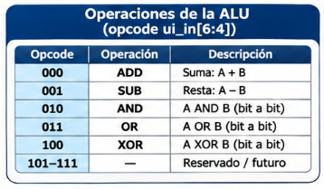
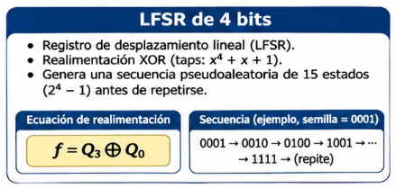
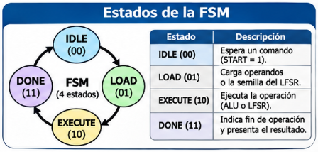

# TT-RANDOM-ALU-4

### A Compact Digital ASIC Design | Tiny Tapeout | GF180MCU

  

  <strong>4-bit ALU + 4-bit LFSR + 4-state FSM</strong>

**TT-RANDOM-ALU-4** is an open-source digital integrated circuit developed in Verilog for the Tiny Tapeout platform.

The design integrates three fundamental digital systems: a 4-bit Arithmetic Logic Unit (ALU), a 4-bit Linear Feedback Shift Register (LFSR) pseudo-random number generator, and a four-state Finite State Machine (FSM) controller.

The project explores digital logic design, sequential circuits, combinational logic, and ASIC implementation.

---

## Architecture

The chip consists of three main functional blocks coordinated by a central finite state machine.

### 1. Arithmetic Logic Unit (ALU)

  

The 4-bit ALU performs five basic arithmetic and logical operations:

- **ADD:** Addition.
- **SUB:** Subtraction.
- **AND:** Bitwise AND.
- **OR:** Bitwise OR.
- **XOR:** Bitwise XOR.

The ALU generates a 4-bit result and status flags, including Carry, Zero, Negative, and Overflow.

### 2. Linear Feedback Shift Register (LFSR)

  

The design incorporates a 4-bit Linear Feedback Shift Register to generate pseudo-random binary sequences.

It uses XOR feedback and a non-zero initial seed. With the implemented feedback recurrence, the generator can traverse up to 15 distinct non-zero states before repeating.

### 3. Finite State Machine (FSM)

  

A four-state Finite State Machine controls the operation of the system:

- **IDLE (00):** Waits for a start command.
- **LOAD (01):** Loads operands, operation code, and LFSR configuration.
- **EXECUTE (10):** Performs the selected ALU operation or advances the LFSR.
- **DONE (11):** Indicates that the operation has been completed.

The FSM coordinates the processing sequence using the system clock.

---

## Input and Output Interface

The design uses the standard Tiny Tapeout interface:

- `ui_in[7:0]`: Eight dedicated input signals for operands and data.
- `uo_out[7:0]`: Eight dedicated output signals for results, flags, and FSM state.
- `uio_in[7:0]`: Eight bidirectional input signals for operation selection and control.
- `uio_out[7:0]`: Output data for the bidirectional pins.
- `uio_oe[7:0]`: Output-enable signals controlling the direction of the bidirectional pins.

The design supports ALU operation selection, operand loading, LFSR seed configuration, and pseudo-random sequence generation.

## ALU Operation Encoding

The ALU supports five operations selected through `uio_in[3:0]`:

| Opcode | Operation |
|:---:|---|
| `0000` | ADD |
| `0001` | SUB |
| `0010` | AND |
| `0011` | OR |
| `0100` | XOR |

---

## Project

### 🎯 Objectives

The main goal of **TT-RANDOM-ALU-4** is to design and implement a compact digital integrated circuit integrating fundamental digital systems into a single ASIC.

The project focuses on the following objectives:

- **Digital Logic Design:** Explore combinational and sequential circuit design using Verilog.
- **ALU Development:** Implement and verify a 4-bit Arithmetic Logic Unit.
- **Pseudo-Random Generation:** Develop a 4-bit LFSR-based pseudo-random number generator.
- **FSM Architecture:** Design and implement a four-state Finite State Machine controller.
- **ASIC Design Flow:** Explore the complete process, from RTL development and functional simulation to synthesis and physical implementation.
- **Open-Source Hardware:** Gain practical experience with semiconductor design through Tiny Tapeout.

---

### 🚧 Development Status

**Current stage:** RTL implementation and functional verification.

The project is being developed through the following milestones:

- [x] Initial Verilog architecture.
- [x] Integration of ALU, LFSR and FSM.
- [x] Initial functional simulation.
- [ ] Automated verification with Cocotb.
- [ ] GF180MCU synthesis and area analysis.
- [ ] Physical design and GDS generation.
- [ ] Tiny Tapeout submission.

---

### 🤝 Acknowledgments

This project is developed as part of the **IEEE Open Silicon Bootcamp 2026**, using the Tiny Tapeout open-source hardware ecosystem.

Special thanks to the Tiny Tapeout community for providing accessible tools and resources for learning digital integrated circuit design.

---

### 🔮 Future Improvements

Potential future developments include:

- Additional arithmetic and logical operations.
- Improvements to the LFSR architecture.
- Expanded FSM functionality.
- Further optimization of area and power consumption.

---

  <strong>Designed with Verilog. Built to explore silicon.</strong>
   
  <em>TT-RANDOM-ALU-4 | Open Source Hardware</em>

